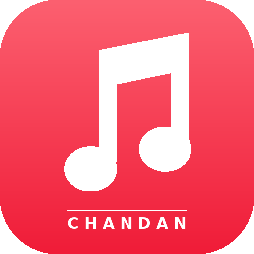
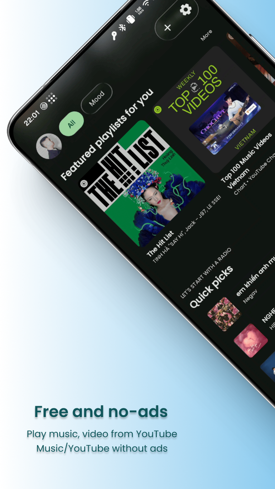
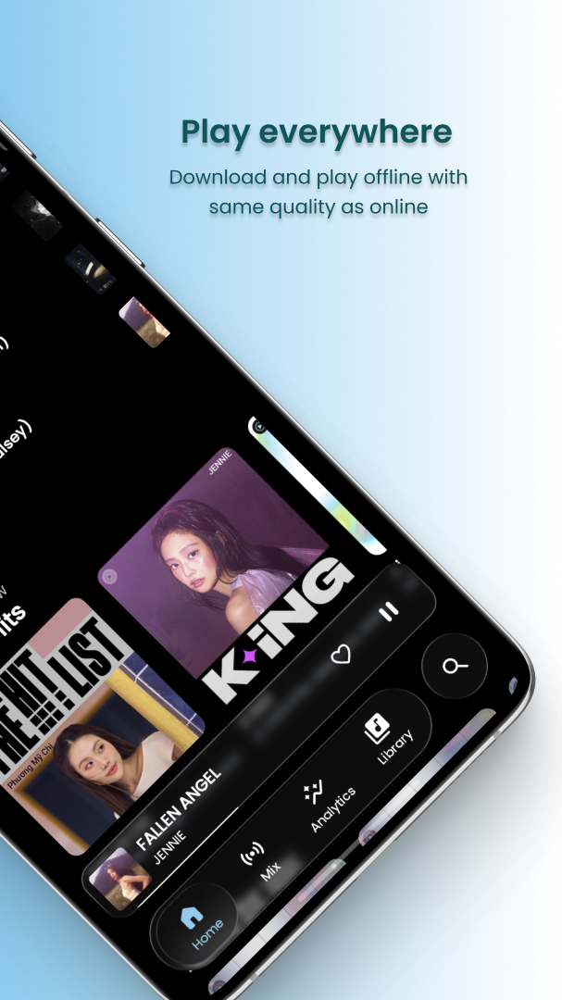
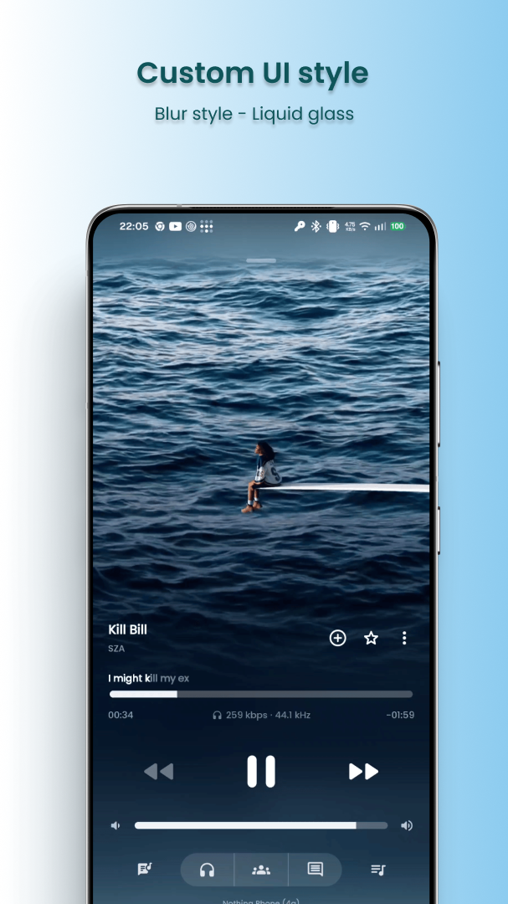
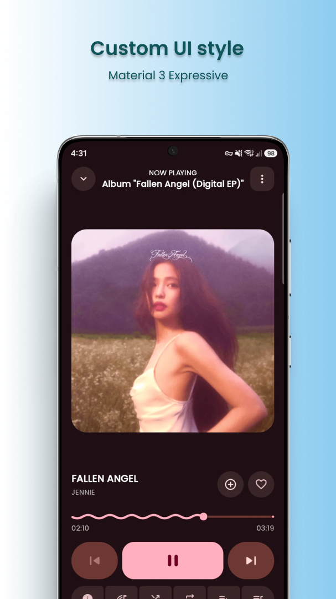
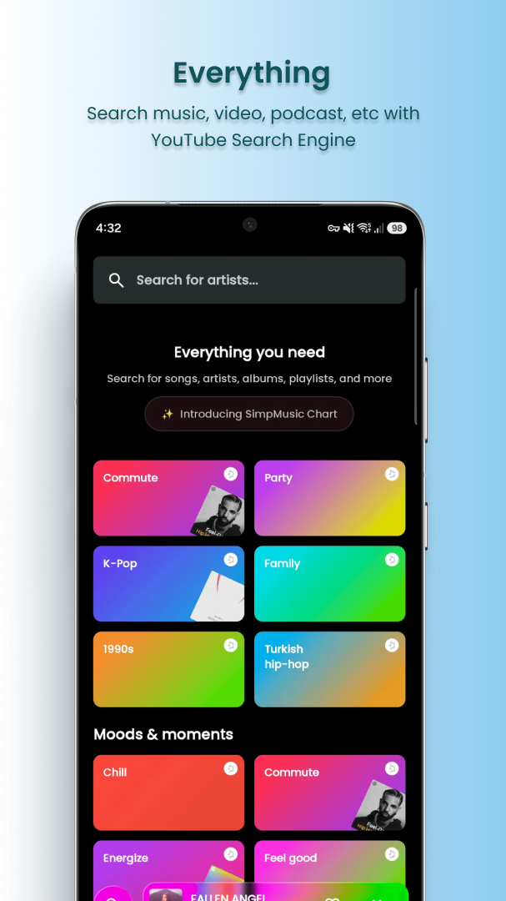
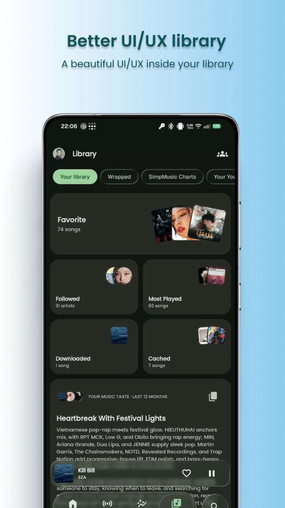
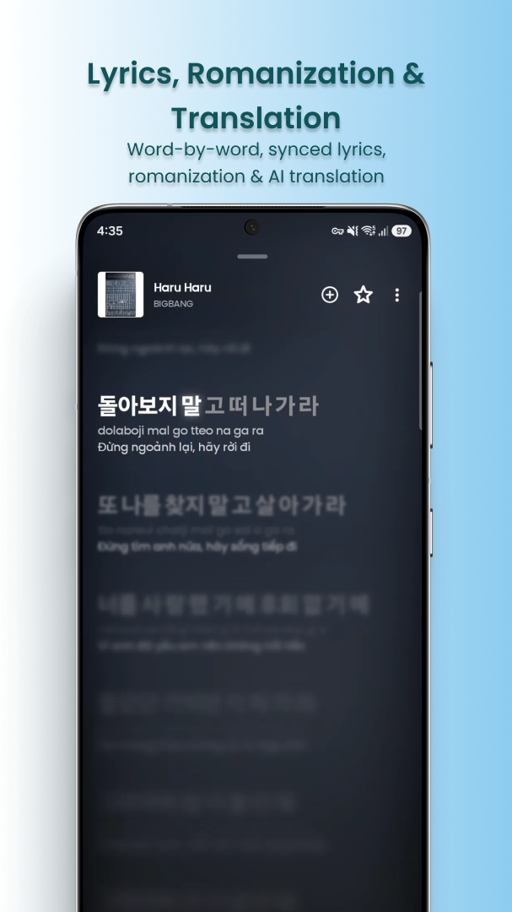
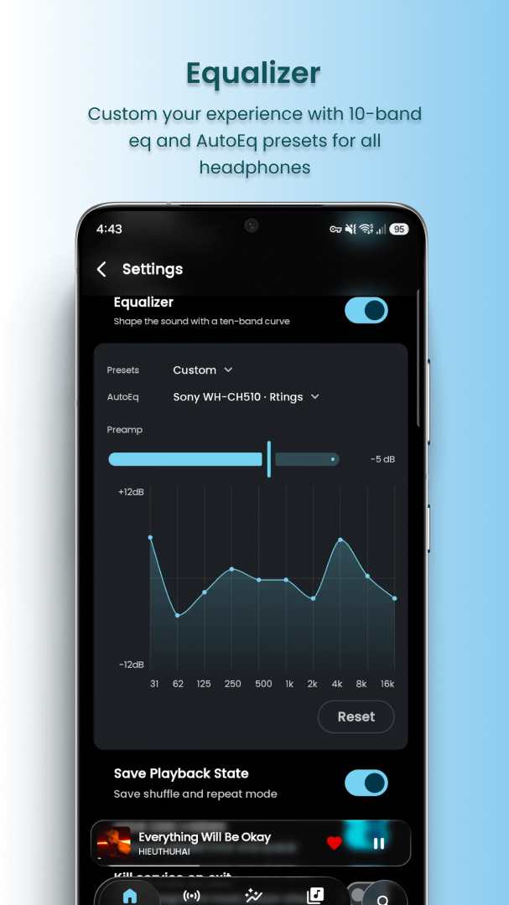

  
  <h1>🎵 Music</h1>
  
<strong>A Modern, Ad-Free Music Streaming Experience for Android</strong>

  
Built with Kotlin Multiplatform & Jetpack Compose

  

    
    
    
    
  

  

    
  

---

## 🌟 Overview

**Music** is a high-performance, ad-free music streaming app for Android powered by modern open-source technologies. It streams high-quality music from YouTube Music without interruptions, providing background playback, offline caching, real-time synchronized lyrics, audio equalization, and a sleek Material 3 user interface.

Developed and maintained by **[Chandan Singh](https://github.com/chandan-itian)**.

---

## 📥 Downloads

Get the pre-signed, install-ready APK for your Android device:

| Package | Architecture | Size | Link |
|---|---|---|---|
| **Music Universal APK** *(Recommended)* | All Android Devices (Universal) | ~57 MB | [**Download Music.apk**](https://github.com/chandan-itian/Music/releases/download/v2.5.0/Music.apk) |
| **Music ARM64 APK** | Modern 64-bit Phones (Fastest) | ~29 MB | [**Download arm64 APK**](https://github.com/chandan-itian/Music/releases/download/v2.5.0/androidApp-arm64-v8a-release.apk) |

> 💡 *Or browse all release assets on the [Official Releases Page](https://github.com/chandan-itian/Music/releases).*

---

## ✨ Features

- 🎧 **Ad-Free Playback:** Stream millions of songs without ads or interruptions.
- 📱 **Background & Lock Screen Playback:** Keep listening while using other apps or with screen turned off.
- 💾 **Offline Caching & Smart Downloads:** Automatically caches played songs and allows manual downloads for offline listening.
- 🎤 **Synchronized Lyrics:** Word-by-word and line-by-line synchronized lyrics with multi-language romanization support.
- 🎚️ **Custom 10-Band Equalizer & AutoEQ:** Tailor your sound profile with headphone presets, reverb, and delay effects.
- 🎨 **Modern Material 3 Interface:** Dynamic color theming, fluid animations, and Apple Music-inspired player styles.
- 📻 **Live Stations & Radio:** Continuous music playback based on your favorite artists, genres, or moods.
- 🔍 **Universal Search:** Instant search for songs, albums, artists, playlists, and music videos.
- 📊 **Listening Analytics:** On-device listening insights, charts, and personalized recaps.
- 🚗 **Android Auto:** Full Android Auto support for in-car listening.
- ⏰ **Sleep Timer:** Automatically stop playback after a set duration.

---

## 📱 Screenshots

  
  
  
  

  
  
  
  

---

## 📲 Installation Guide

1. Download **[Music.apk](https://github.com/chandan-itian/Music/releases/download/v2.5.0/Music.apk)** to your Android phone.
2. Tap the downloaded APK file.
3. If your browser asks to *"Install unknown apps"*, tap **Settings** and turn on **"Allow from this source"**.
4. Tap **Install** and launch **Music**!

---

## 🛠️ Architecture & Tech Stack

This project uses modern Android development practices and Kotlin Multiplatform:
- **Language:** Kotlin 2.x
- **UI Framework:** Jetpack Compose & Compose Multiplatform (Material 3)
- **Architecture:** Clean Architecture + MVVM Pattern
- **Media Engine:** AndroidX Media3 / ExoPlayer
- **Dependency Injection:** Koin
- **Local Storage:** Room Database + DataStore Preferences
- **Networking:** Ktor + OkHttp

---

## 👤 Author & Connect

- **Author:** Chandan Singh
- **Instagram:** [@chandan_krr_singh](https://www.instagram.com/chandan_krr_singh)
- **GitHub:** [@chandan-itian](https://github.com/chandan-itian)

---

## ⚖️ Legal Disclaimer

- **Non-Commercial & Educational:** This project is strictly for personal and educational use. It is 100% free with no ads, no subscriptions, and no paid features.
- **Content Ownership:** This app does not host, upload, or store any copyrighted audio or media files on personal servers. All audio streams are rendered directly from public YouTube / YouTube Music APIs.
- **Support Creators:** We strongly encourage supporting musicians and content creators by subscribing to official platforms such as [YouTube Premium](https://www.youtube.com/premium).

---

  Music v2.5.0 • Developed with ❤️ by Chandan Singh

